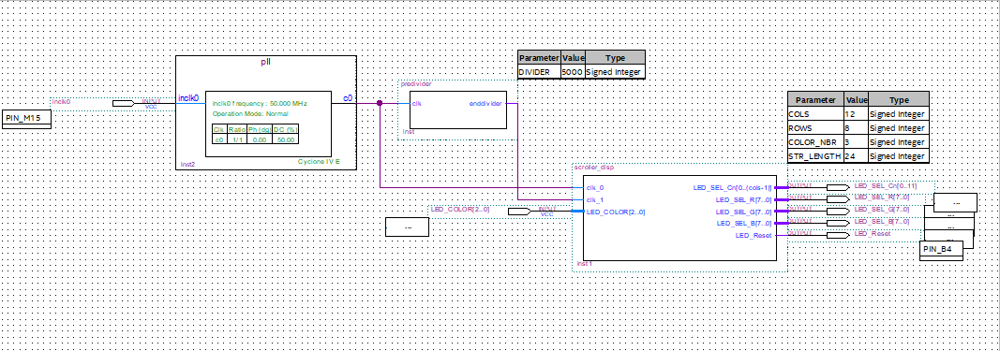

# EPAC LED Matrix Scrolling Display


[](LICENSE)

Reference solution for the lab *"Affichage de texte défilant sur matrice de LEDs multiplexée avec FPGA"*.
The word **EPAC** scrolls across an 8×12 multiplexed LED matrix driven by an Altera Cyclone IV FPGA on a Terasic DE0-NANO board.

## Demo

https://github.com/user-attachments/assets/772d46bc-31ce-463b-a946-46a0ce6721a8

https://github.com/user-attachments/assets/385eaee7-e9c6-45bd-9127-cec57e11e444

## Table of contents

1. [Overview](#overview)
2. [Architecture](#architecture)
3. [Design blocks](#design-blocks)
4. [Hardware and software requirements](#hardware-and-software-requirements)
5. [Build and program](#build-and-program)
6. [Controls](#controls)
7. [Pin assignment](#pin-assignment)
8. [Simulation](#simulation)
9. [Corrections to the original handout](#corrections-to-the-original-handout)
10. [Repository structure](#repository-structure)
11. [Author](#author)
12. [License](#license)

## Overview

The design displays a scrolling text message on a multiplexed LED matrix. The matrix is scanned one column at a time at high speed, and persistence of vision makes the eye perceive a stable image. The message is stored as a bitmap in a VHDL package and shifted left by one column at each scroll step.

Topics covered by the lab:

- Hierarchical VHDL design with generics
- LED multiplexing (column scanning, active-low select)
- Persistence of vision
- Separation of two timing domains: pixel refresh (1 kHz) and scroll step (1 Hz)
- Mixed design entry: Quartus block diagram (`.bdf`) as top level, VHDL for leaf entities
- Simulation of leaf entities in ModelSim

The lab was organized in small groups of student

## Architecture

```
CLOCK_50 (PIN_M15)
      |
      v
+-------------+     clk_pixel (1 kHz)      +-----------------+
| predivider  |--------------------------->|                 |
| /50 000     |     clk_scroll (1 Hz)      |  scroller_disp  |---> LED matrix
| /50 000 000 |--------------------------->|  8x12           |
+-------------+                            +-----------------+
                                                    ^
                                                    |
                                        LED_COLOR (3 switches)
```

The top level is a Quartus block diagram that instantiates the VHDL entities and wires the color switches to the display inputs.



## Design blocks

| Block | File | Role |
|-------|------|------|
| `text_pkg` | `rtl/text_pkg.vhd` | Bitmap of the message (24 columns × 8 rows) and the color type |
| `predivider` | `rtl/predivider.vhd` | Generic clock divider, derives slower clocks from the 50 MHz system clock |
| `scroller_disp` | `rtl/scroller_disp.vhd` | Column multiplexing and scrolling shift register |
| `Lab` | `quartus/Lab.bdf` | Top-level schematic |

### Clocks

| Signal | Division | Frequency | Purpose |
|--------|----------|-----------|---------|
| `clk_pixel` | 50 000 | 1 kHz | Column multiplexing and refresh |
| `clk_scroll` | 50 000 000 | 1 Hz | Scroll step |

### Bitmap encoding

Each byte is one column, with the most significant bit as the top row. Each letter uses 4 columns, and 2 blank columns separate letters, giving 24 columns for the full string.

| Letter | Column bytes |
|--------|--------------|
| E | `FE 92 92 92` |
| P | `FE 90 90 F0` |
| A | `FE 90 90 FE` |
| C | `FE 82 82 82` |

## Hardware and software requirements

**Hardware**

| Item | Specification |
|------|---------------|
| FPGA board | Terasic DE0-NANO, Altera Cyclone IV EP4CE22F17C6N |
| Display | 8×12 multiplexed RGB LED matrix |
| Expansion | EPFL/LAP `ExtDE0_LedSW` shield |
| Power and programming | USB mini-AB (5 V), USB-Blaster |


**Software**

- Quartus Prime Lite Edition 18.1 or later
- ModelSim Altera Starter Edition
- USB-Blaster driver

## Build and program

1. Clone the repository:

   ```bash
   git clone https://github.com/Peace-ADIKEPETO/Quartus_LAB.git
   cd Lab
   ```

2. Open the project in Quartus:

   ```bash
   quartus quartus/lab.qpf
   ```

3. Compile with **Processing → Start Compilation** (Ctrl+L), or from the command line:

   ```bash
   quartus_sh --flow compile quartus/Lab
   ```

4. Program the board:
   1. Connect the DE0-NANO through the USB-Blaster.
   2. Open **Tools → Programmer**.
   3. Load `quartus/output_files/Lab.sof`.
   4. Click **Start**.

The text EPAC then scrolls continuously from right to left.

## Controls

| Input | Function |
|-------|----------|
| `SW[2]` | Red channel enable (active low) |
| `SW[1]` | Green channel enable (active low) |
| `SW[0]` | Blue channel enable (active low) |
| `KEY[0]` | Reset (active low) |

## Pin assignment

The complete assignment is in `quartus/epac_scroller.qsf`. Summary:

| Signal | Pin | Direction |
|--------|-----|-----------|
| `CLOCK_50` | `PIN_M15` | in |
| `LED_COLOR[2]` | `PIN_E9` | in |
| `LED_COLOR[1]` | `PIN_C9` | in |
| `LED_COLOR[0]` | `PIN_D9` | in |
| `LED_Reset` | `PIN_B4` | out |
| `LED_SEL_R[0..7]` | `PIN_N14` … `PIN_R12` | out |
| `LED_SEL_G[0..7]` | `PIN_L13` … `PIN_T10` | out |
| `LED_SEL_B[0..7]` | `PIN_M10` … `PIN_T11` | out |
| `LED_SEL_Cn[0..11]` | `PIN_B5` … `PIN_C8` | out |


## Simulation

Leaf entities can be simulated independently in ModelSim from the `sim/` directory:

```bash
cd sim
vsim -do run_sim.do
```

Intended checks:

- Divider output period of `predivider`
- Left-scrolling behavior of the `scroller_disp` shift register
- Column selection timing

## Repository structure

```
quartus_lab/
├── rtl/
│   ├── text_pkg.vhd
│   ├── predivider.vhd
│   └── scroller_disp.vhd
├── quartus/
│   ├── Lab.qpf
│   ├── Lab.qsf
│   ├── Lab.bdf
│   └── Lab.sdc
├── simulation/
├── docs/
│   ├── Travaux Pratiques.pdf
│   └── *.png
├── .gitignore
├── LICENSE
└── README.md
```

## Authors

**Peace ADIKPETO**
Teaching Assistant, EPAC
peaceadikpeto@gmail.com
**KIKI Probus A. F. M.**
Supervisor, Main-Lecturer, PhD, EPAC

## License

Released under the MIT License. See [`LICENSE`](LICENSE).
